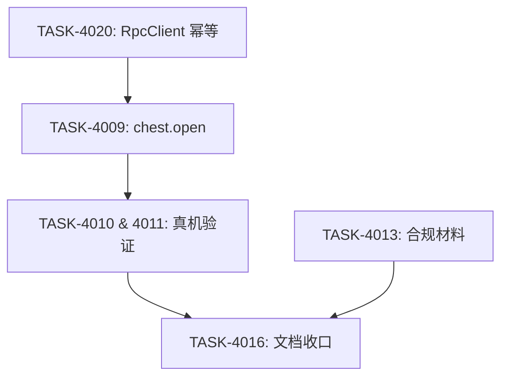

# 8. 原子任务卡全集

包含以下卡片（详情落入 `docs/05_execution/tasks/`）：
- **TASK-4020**: RpcClient 自动补齐 `rid`。
- **TASK-4009**: 开锁交互（chest+locks 接表）+ `chest.open` 动作。
- **TASK-4010 & 4011**: 真机验证与命中率采样。
- **TASK-4013**: 合规材料清单。
- **TASK-4016**: 文档对齐与收口。

## 8.1 依赖 DAG

- **可并行组**：T4020 与 T4013 可并行。
- **关键路径**：T4020 -> T4009 -> T4010 -> T4016。

## 8.2 所有权矩阵

| Agent | 负责路径 |
|---|---|
| Agent-Contract | `packages/contracts/**` |
| Agent-Data | `game-data/source/*.csv` |
| Agent-API | `server/src/modules/chest/**`, `server/src/gateway/**` |
| Agent-App | `client/assets/scripts/features/salvage/**`, `client/assets/scripts/services/net/**` |

## 8.3 档位分配

- **TASK-4020**: sonnect (明确的工具层修改)
- **TASK-4009**: opus (涉及 UI 与核心机制联调)
- **TASK-4010/4011**: haiku (降级标 UNKNOWN)
- **TASK-4013/4016**: haiku (文档整理)
